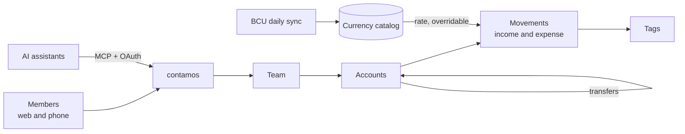

<div align="center">

# 📒 contamos

**One shared ledger for everyone you share money with.**

[](https://github.com/scajal/contamos/actions/workflows/tests.yml)
[](LICENSE)


*A multi-currency ledger for couples, flatmates, families and small side projects. Spanish first, English too.*

</div>

---

Every member of a group records the group's real money movements (income, expenses and transfers between accounts), and everyone sees the same numbers. Contamos is not a debt splitter and it is not accounting software. Each movement can carry its own exchange rate, so a group that lives across currencies (for example pesos and dollars) can keep one honest ledger.

> [!NOTE]
> Contamos ran as a hosted service at contamos.xyz until November 2026. The service has been shut down, and this repository is its complete source code, published as-is under the MIT license. It is not actively maintained, but you are welcome to run it, fork it and learn from it.

---

## ✨ Features

| | Feature | What it does |
| --- | --- | --- |
| 👥 | **Teams** | A team is the unit of sharing. Members are invited by email and hold a role (owner, admin or member), and every change lands in an activity log. |
| 🏦 | **Accounts and movements** | You get accounts in any currency, income and expense movements, transfers between accounts, and tags. |
| 💱 | **Multi-currency** | Exchange rates come from a currency catalog, and you can override the rate on any movement. Uruguayan peso rates sync daily from the BCU (Banco Central del Uruguay). |
| 📊 | **Monthly view and dashboard** | Review a month at a glance, with charts. |
| 🔁 | **Recurring movements and budgets** | Rules generate movements on schedule, budgets send alerts, and a summary email goes out every month. |
| 🤖 | **MCP server** | AI assistants read and write a team's ledger over the [Model Context Protocol](https://modelcontextprotocol.io), with OAuth authorization. |
| 💳 | **Billing** | Free and Pro plans run through Paddle. An operator can also grant Pro to a team by hand. |
| 🛡️ | **Administration** | Filament panels let operators manage users, teams and the currency catalog. |

---

## 🗺️ At a glance



| Layer | Technology |
| --- | --- |
| Backend | Laravel 13 on PHP 8.4, Laravel Pennant for plan features, Laravel MCP |
| Frontend | Inertia v3, React 19, TypeScript, Tailwind CSS v4, shadcn/ui, Recharts, Motion, and Wayfinder for typed routes |
| Admin panels | Filament 5 |
| Sign-in | WorkOS AuthKit |
| Billing | Paddle, through Laravel Cashier |
| Email | Resend |
| Database | SQLite locally and MySQL 8 in production |
| Quality | Pest, PHPStan (Larastan), Rector, Pint, and Vite+ for lint and format |

---

## ⚡ Quick start

```bash
git clone https://github.com/scajal/contamos.git
cd contamos
composer setup          # deps, .env, app key, SQLite, migrations, frontend build
php artisan db:seed     # base currency (UYU)
composer dev            # server, queue, logs and Vite
```

The app runs at `http://localhost:8000`.

> [!IMPORTANT]
> Contamos has no password login. You need a [WorkOS](https://workos.com) application before you can sign in (the free tier is enough). Add `${APP_URL}/authenticate` as a redirect URI in WorkOS.

### 🔑 Environment

| Key | Required | Purpose |
| --- | --- | --- |
| `WORKOS_CLIENT_ID`, `WORKOS_API_KEY`, `WORKOS_AUTHKIT_DOMAIN` | ✅ | Sign-in |
| `ADMINISTRATION_OPERATORS` | | Comma separated emails allowed into the Filament panels at `/administration` |
| `PADDLE_*`, `PRODUCT_PRO_*` | | Billing, with the Paddle product and price ids of the Pro plan (a sandbox account works) |
| `RESEND_API_KEY` | | Outgoing email when `MAIL_MAILER=resend`. Locally, `MAIL_MAILER=log` writes emails to the log instead. |
| `GOOGLE_ANALYTICS_MEASUREMENT_ID` | | Google Analytics |

### ⏰ Scheduled work

In production, run the scheduler every minute (`php artisan schedule:run`). It syncs exchange rates, generates recurring movements, sends the monthly summaries and prunes the activity log.

---

## 🧱 Project layout

The application code lives in modules under `app/Modules`:

| | Module | What it holds |
| --- | --- | --- |
| 🪪 | `Core/Identity` | Users, teams, members, roles, invitations and the activity log |
| 💰 | `Core/Finance` | Accounts, movements, transfers, tags, budgets, recurring rules and reports |
| 💱 | `Core/Catalog` | Currencies, exchange-rate quotes and quote providers |
| 💳 | `Billing` | Plans, Paddle subscriptions and plan features |
| 🔐 | `Authentication` | WorkOS AuthKit sign-in |
| 🛡️ | `Administration` | Filament panels |
| 🤖 | `Mcp` | The MCP server, tools and prompts |
| 🌐 | `Marketing` | Public pages, legal pages and the sitemap |
| 🧰 | `Support` | Shared concerns, middleware and helpers |

The React pages live in `resources/js/pages`, and translations in `lang/` (`es.json`, `en.json`).

> [!NOTE]
> The legal pages under `resources/markdown/legal` were written for the hosted service. They do not apply to your own deployment.

---

## 🤖 Working with AI agents

The project was built with coding agents, and their context lives in the tree:

| | Path | What it holds |
| --- | --- | --- |
| 📘 | `AGENTS.md`, `CLAUDE.md` | Laravel Boost guidelines |
| 📏 | `.ai/rules/` | Project rules, mapped to file globs in `.ai/rules/index.md` |
| 🎨 | `PRODUCT.md`, `DESIGN.md` | Product and design briefs |
| 🧩 | `.agents/skills/` | Agent skills |

---

## ✅ Before you push

```bash
composer lint           # rector, pint, phpstan
composer test           # lint check and the Pest suite
pnpm run check          # frontend lint and format
pnpm run types:check    # TypeScript
```

CI runs the suite on SQLite and again on MySQL 8.4 in strict mode, on every push to `main` and every pull request.

---

<div align="center">

[MIT](LICENSE) © 2026 Santiago Cajal

</div>
